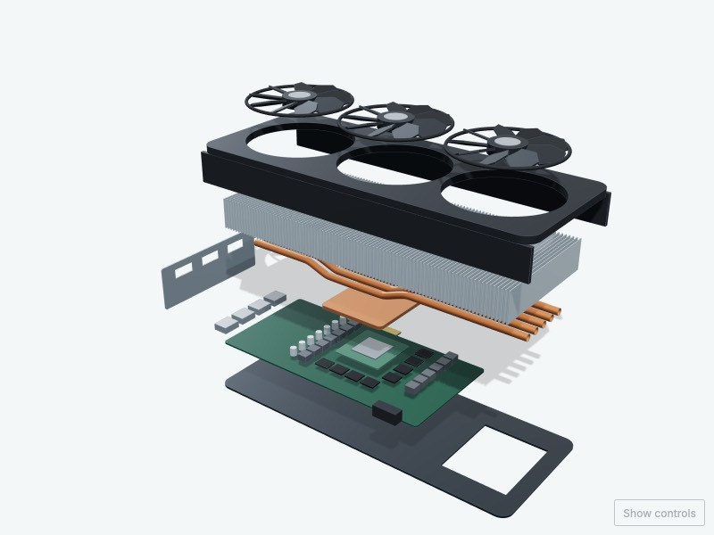

# Fable of Contents

Ask for a machine. Get a 3D model you can turn, pull apart and step through part by part.



Each model is a JSON parts list. The page draws it with three.js, moves every part between its assembled and pulled-apart position, and shows one or two sentences about what each part does. An AI writes the parts list from a description.

## Try it

```bash
python3 -m http.server 8000
```

Open `http://localhost:8000`. The page needs a web server because it loads the model files. Nothing has to be installed.

- Drag to turn the model, and use the slider to pull it apart.
- Tap a part to see what it does.
- "Start tour" visits every part in order.
- "Hide controls" (or the C key) leaves only the model, for recording. Space pulls it apart, T starts the tour.

Useful addresses: `#graphics-card` opens a model directly, `?open=1` starts pulled apart, `?clean=1` starts without controls.

## Make your own model

There are two ways, and both run on your own account.

**With Claude Code.** Open this folder in Claude Code and ask: "make a model of a jet engine". The `make-model` skill researches the part layout, writes `models/jet-engine.json`, renders it, and fixes what looks wrong. Rendering uses Google Chrome on a Mac.

**With a Claude page.** Run `python3 tools/build.py` and publish `dist/claude-page.html` as a page from your own Claude. Inside Claude, the page has an "Ask for something else" box. Claude builds the model, using your Claude usage after asking you. It can also read the explanation aloud and take questions by microphone where your browser allows it.

You can also write a model by hand, or with any other AI: give it `prompt.txt` and open the result with "Open a model file".

## The format

`prompt.txt` is the whole specification, written as the instruction the AI gets. In short:

- A model has `parts` and `steps`. Sizes are in millimetres, y is up.
- A part has one or more `shapes`, a position, and an `explode` vector: how far it moves when pulled apart. `stage` sets the order.
- Shapes are `box`, `plate` (with holes), `extrude`, `cyl`, `tube`, `lathe`, `torus` and `sphere`. `array` and `radial` repeat a shape, which is how fins, blades and teeth are made.
- A step names a part and says what it does.

Check a model with `python3 tools/check.py models/your-model.json`. Add `--shot` to render its pictures.

## Limits

- Models are built from simple solids. There are no cut-outs between solids, no freeform surfaces and no textures, so organic shapes come out crude.
- The AI places parts by numbers and gets positions wrong. Expect to fix floating or overlapping parts. The skill does this by looking at the rendered pictures.
- The explanations are written by an AI. Each model's `note` says what was checked, and `sources` lists the pages it was checked against. Treat anything else as unverified.
- The page never runs code from a model file. It reads values and clamps them, so a bad model draws badly and the page keeps working.

## License

MIT.
